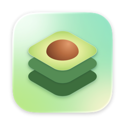
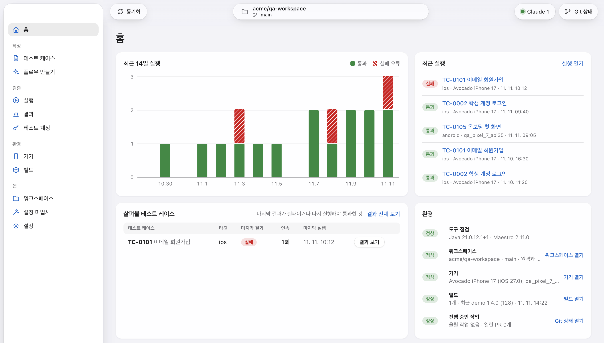
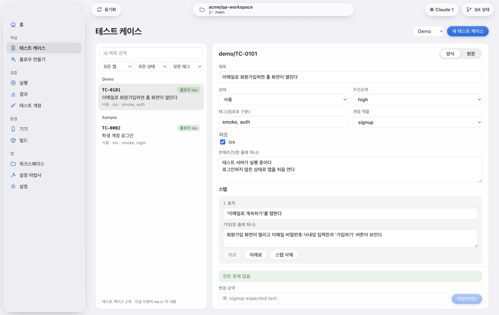
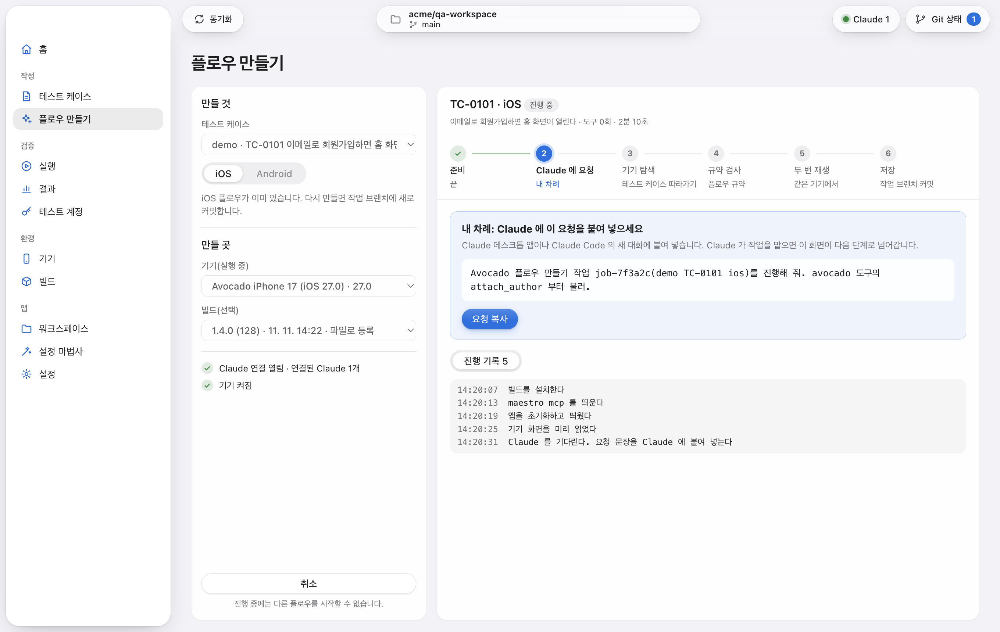
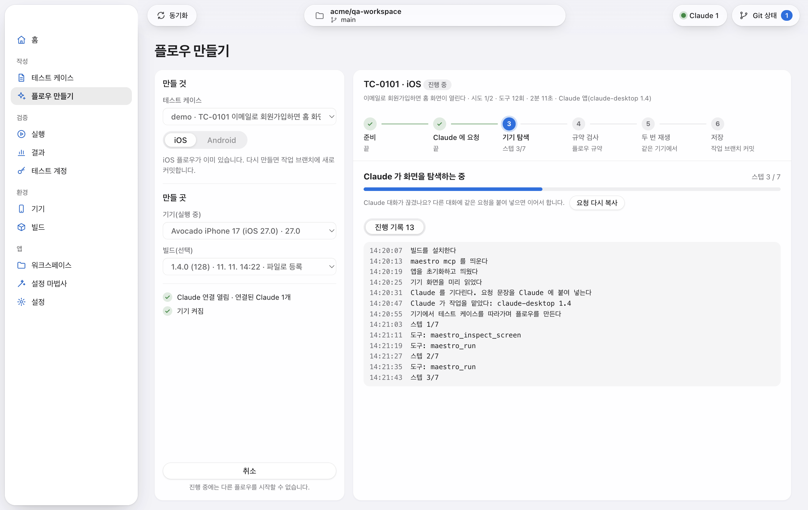
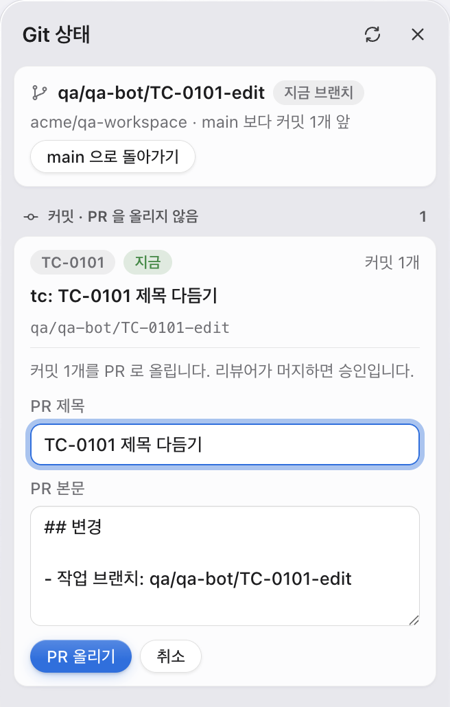
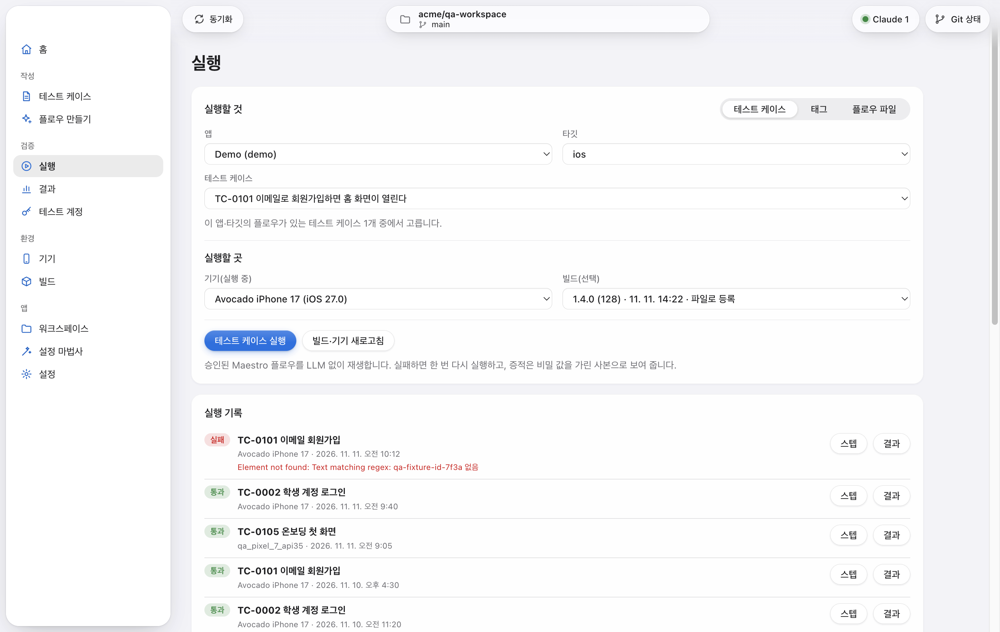
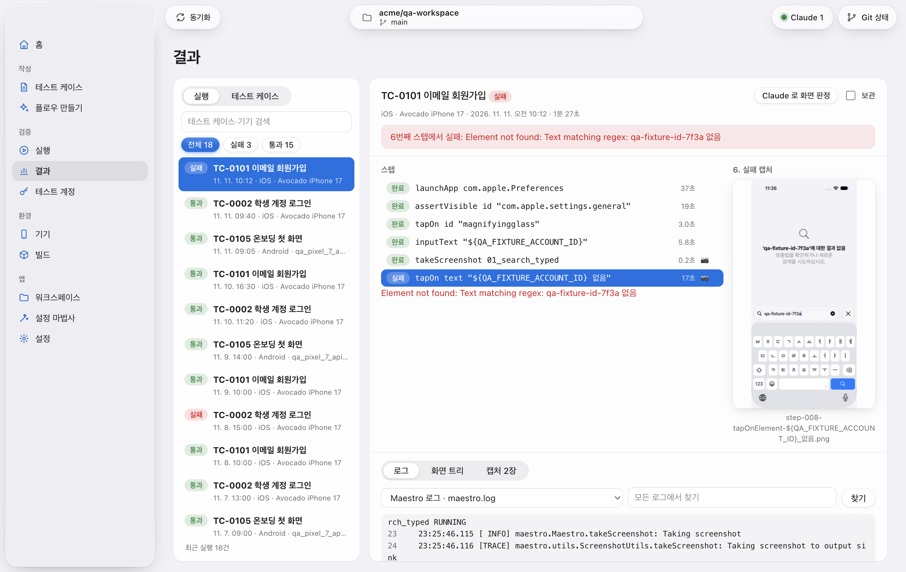

<div align="center">



# Avocado

**A macOS app that tests mobile apps from test cases written in plain language.**<br>
Your own Claude turns each test case into a Maestro flow. Approved flows replay without AI and leave evidence for every step.

[](https://github.com/Ekko0701/Avocado/releases/latest)
[](https://github.com/Ekko0701/Avocado/releases)


[](LICENSE)

[한국어](README.md) · **English** · [日本語](README.ja.md)

</div>



- **Test cases in plain language**: planners and QA fill in an action and its expected result in a form inside the app. A rule check (lint) runs on every save.
- **Your Claude writes the flow**: Claude Desktop or Claude Code follows the test case on a simulator and writes the Maestro flow. No API key is needed.
- **Replay uses no AI**: approved flows run as they are with Maestro. No model is called during a run.
- **Evidence for every step**: a step timeline, screenshots, the view hierarchy and logs. Secrets such as account values appear only in redacted copies.
- **No server**: test cases and flows live in your team's GitHub repository and are approved through pull requests. Raw evidence stays on each person's Mac.

> The app's interface is in Korean only for now. This guide gives each menu and button name as it appears on screen, followed by its meaning in English.

## Installation

Avocado runs on **Apple silicon Macs** (M1 or later). Intel Macs are not supported.

1. Download `Avocado-<version>-arm64.dmg` from the
   [latest release](https://github.com/Ekko0701/Avocado/releases/latest).
2. Open the DMG and drag **Avocado** into **Applications**.
3. Open Avocado from Applications.

Releases are signed and notarized by Apple, so the app opens without a security warning.

### What else you need

| Item | Details |
|---|---|
| Xcode | Install it from the App Store and open it once to install the additional components. You also need an iOS simulator runtime (Xcode → Settings → Components). |
| Claude | Claude Desktop or Claude Code, used to create flows. Usage counts against your own Claude plan. |
| GitHub | A workspace repository (test cases and flows) and a token that can write to it. Add an evidence repository if you want to upload evidence summaries. |
| Android (optional) | The Android Studio SDK and an emulator, only if you test Android. |

You don't install Maestro or Java yourself. Avocado's setup wizard downloads fixed versions and keeps them for its own use (about 360 MB).

### Updating

When a new version is out, a banner appears in the app. Click **받기** (Download) and Avocado checks the SHA-256 and the signature of the downloaded file. Then click **재시작해서 업데이트** (Restart to update) and the app reopens as the new version. If a run, a flow creation or a build is in progress, wait until it finishes.

If the app is outside the Applications folder, the banner's button reads **설치 파일 받기** (Get installer) instead. Install again from the DMG it downloads.

### Uninstalling

1. In **기기** (Devices), delete the simulators Avocado created (`Avocado iPhone …`) with **삭제** (Delete).
2. Move Avocado to the Trash.
3. To remove everything it stored, also delete `~/Library/Application Support/Avocado` (database, evidence, workspace, tools, logs) and the **Avocado Safe Storage** item in Keychain Access.
4. If you registered Avocado with Claude, remove the `avocado` entry from the Claude Desktop config file. For Claude Code, run the command below.

```bash
claude mcp remove avocado
```

## Usage

### 1. First-time setup

The setup wizard opens on first launch. It has six steps, and any step you skip can be done later from the menu on the left.

1. **Claude 연결** (Connect Claude): for Claude Desktop, click **Claude 데스크톱 앱에 등록** (Register with Claude Desktop) and reopen Claude. For Claude Code, copy the command shown and run it once in a terminal.
2. **GitHub 토큰** (GitHub token): enter a fine-grained token with read and write access to Contents and Pull requests.
3. **환경 점검·도구** (Environment check and tools): checks Xcode and the simulator runtime, then installs Java and Maestro.
4. **GitHub·워크스페이스** (GitHub and workspace): choose the workspace repository from the list and connect it.
5. **QA 기기** (QA device): prepares an iOS simulator (1 to 3 minutes).
6. **완료** (Done)

Tokens and account values are encrypted with a macOS Keychain key and stay on this Mac. The screen only shows whether a value is saved.

The full walkthrough is in [Installation and first run](docs/user-guide/install.md) (Korean).

### 2. Prepare a device and a build

- **Device**: in **기기** (Devices), choose an iOS version and a model, then click **iOS 시뮬레이터 준비** (Prepare iOS simulator). Avocado creates its own simulator, sets its language and boots it. For Android, choose an AVD and click **Android 에뮬레이터 준비** (Prepare Android emulator).
- **Build**: in **빌드** (Builds), add the app you want to test.
  - **프로젝트** (Project): connect an Xcode project folder, choose a scheme and a configuration, and click **빌드 시작** (Start build). Avocado builds for the simulator and registers the result.
  - **파일** (File): choose a simulator `.app` or an `.apk` you built yourself.
  - **스크립트** (Script): run your team's build script and register what it produces.
- **Test accounts**: in **테스트 계정** (Test accounts), enter a value for each key the workspace defines. Avocado reads them only when a flow runs and redacts them in the evidence.

### 3. Write a test case

In **테스트 케이스** (Test cases), click **새 테스트 케이스** (New test case) and fill in the form. Each step has one action and its expected result.



**저장(커밋)** (Save and commit) commits the linted content to that test case's work branch. Nothing goes straight to main. The format and the rules are in [Writing test cases](docs/user-guide/testcase.md) (Korean).

### 4. Create a flow with Claude

1. Open Avocado first, then open Claude.
2. In **플로우 만들기** (Create flow), choose the test case, target, device and build, then click **Claude 로 플로우 만들기** (Create flow with Claude).
3. The "Claude 에 요청" (Ask Claude) step is your turn. Click **요청 복사** (Copy request) and paste it into a Claude conversation.



4. Claude follows the test case on the device and builds the flow. The step bar and the progress log show how far it has got.



5. When Claude submits the flow, Avocado checks it against the flow conventions and replays it twice on the same device. It is committed to the work branch only if both replays pass.

Claude never sees values such as account passwords. Avocado injects them at run time and redacts them in the results. Screenshots and on-screen text do go to your own Claude account, so for an app with sensitive screens, check your plan and whether your conversations may be used for model training first. More in [Creating flows with your Claude](docs/user-guide/claude-connect.md) (Korean).

### 5. Open a pull request for approval



**Git 상태** (Git status) at the top shows the commits on each work branch. Click **PR 작성** (Write PR), enter a title and a body, and click **PR 올리기** (Open PR). When a reviewer merges it on GitHub, the change is approved. Avocado never pushes to main and never merges a pull request by itself.

### 6. Run

In **실행** (Run), choose what to run and where, then click the run button.

- **테스트 케이스** (Test case): replays one test case that has a flow.
- **태그** (Tag): replays every test case with that tag, one after another.
- **플로우 파일** (Flow file): replays a `.yaml` file that is not in the workspace, once.



A failed run is retried once. A run that passes on the retry is marked "불안정" (flaky).

### 7. Read results and evidence

In **결과** (Results), choose a run on the left. The steps and the screenshot of the failed step appear side by side on the right, and the log tab below opens at the failing line. The view hierarchy and all screenshots are in the other tabs.



- Filter the list by failed or passed, or search it. The **테스트 케이스** (Test cases) tab shows the latest result as a table of test cases by target.
- **Claude 로 화면 판정** (Judge screens with Claude) asks Claude whether each screenshot shows a normal screen. The verdict appears only as a badge and never changes the run result.
- The evidence on screen is a redacted copy. The raw files stay on this Mac.

### What is supported

| Target | Supported | Notes |
|---|---|---|
| iOS simulator | ✅ | An Xcode project folder, or a simulator `.app` |
| Android emulator | ✅ | `.apk` |
| Android phone | ⚠️ | Connects over USB debugging. Implemented, but not yet tested enough on real phones. |
| iPhone (real device) | ❌ | Not supported yet. TestFlight builds are device builds, so they cannot be used either. |
| Android `.aab`, Gradle project builds | ❌ | Build an `.apk` and register that. |

## Documentation

The guides are in Korean.

- [Installation and first run](docs/user-guide/install.md)
- [Creating flows with your Claude](docs/user-guide/claude-connect.md)
- [Writing test cases](docs/user-guide/testcase.md)
- [Example workspace](examples/qa-workspace): test cases and flows for made-up apps

## Development

Building from source and the repository layout are described in [docs/development.md](docs/development.md) (Korean).

## License

[MIT](LICENSE) © 2026 Ekko0701
