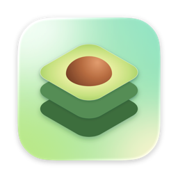
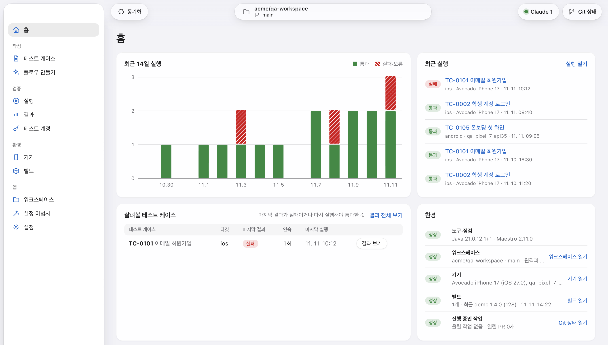
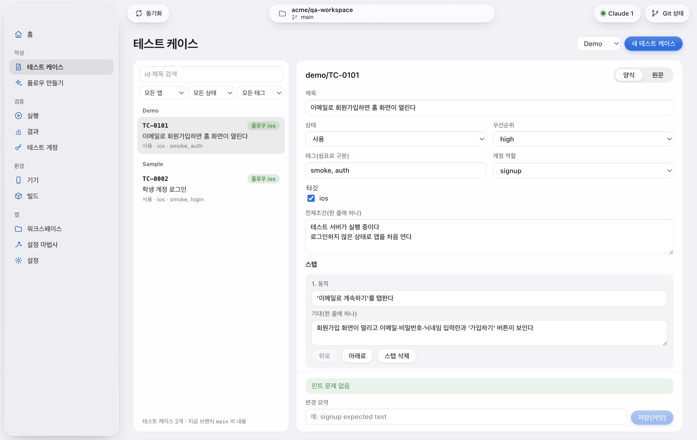
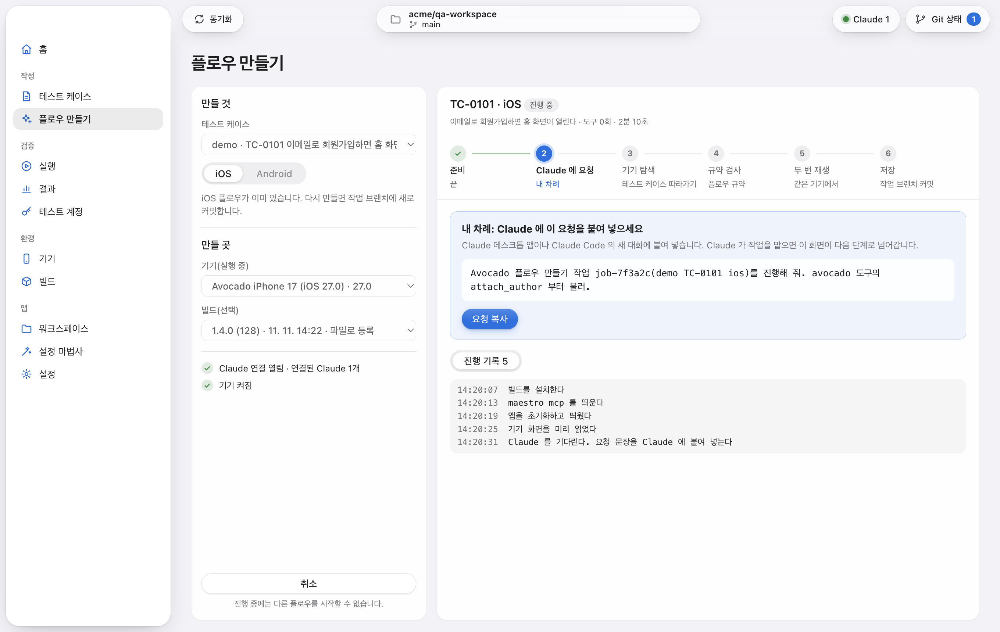
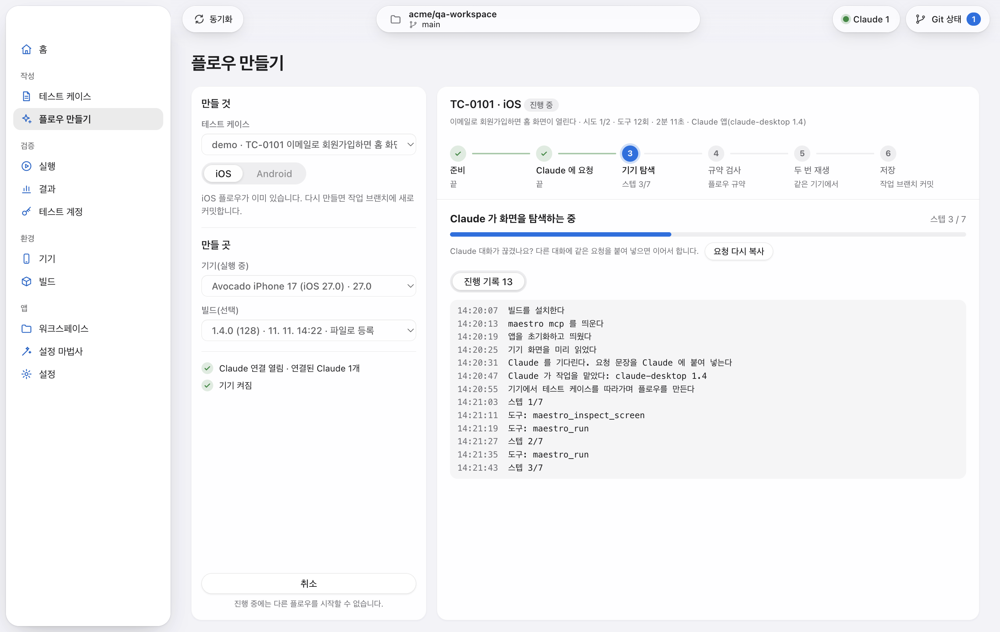
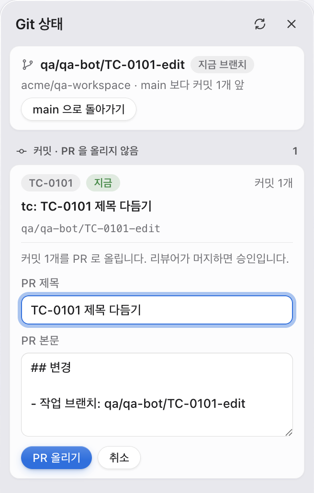
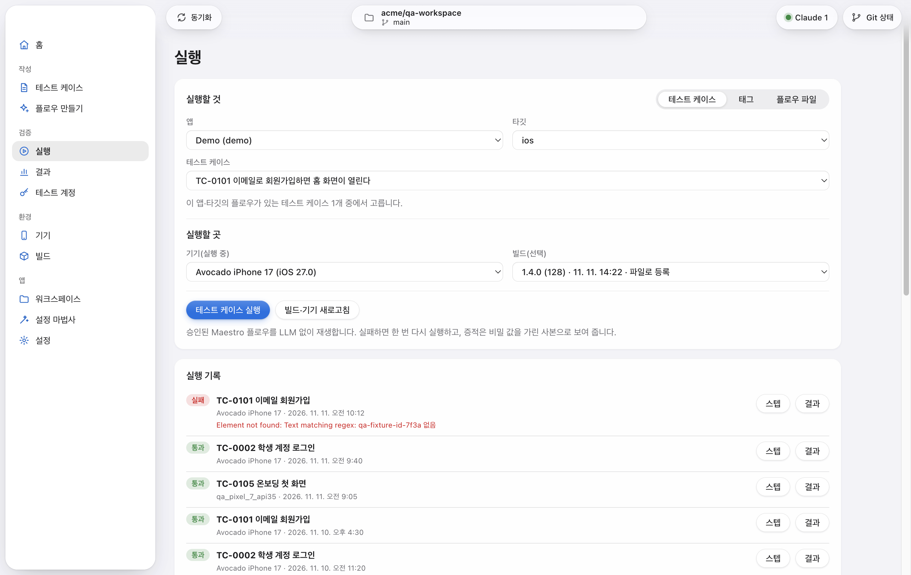
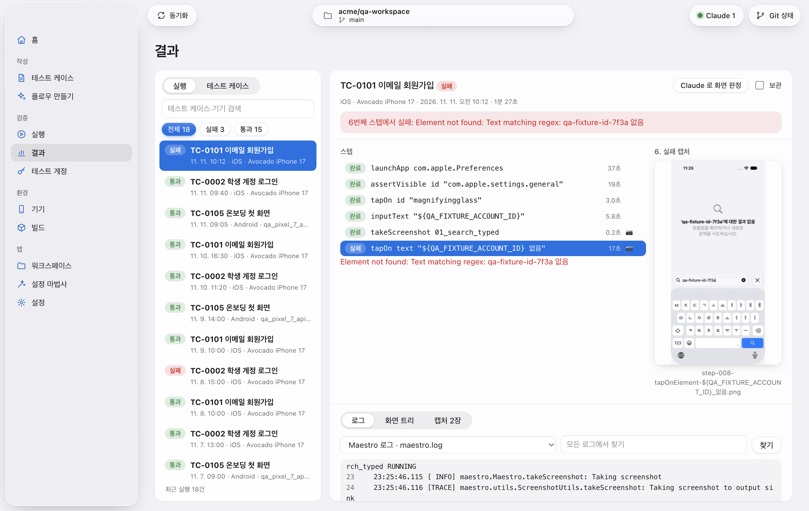

<div align="center">



# Avocado

**自然言語で書いたテストケースでモバイルアプリを検証する macOS アプリ。**<br>
自分の Claude がテストケースを Maestro フローにし、承認されたフローは AI なしで再生してステップごとに証跡を残します。

[](https://github.com/Ekko0701/Avocado/releases/latest)
[](https://github.com/Ekko0701/Avocado/releases)


[](LICENSE)

[한국어](README.md) · [English](README.en.md) · **日本語**

</div>



- **テストケースは自然言語で**: 企画担当者や QA が、アプリ内のフォームに操作と期待結果を書きます。保存のたびにルール検査（リント）が走ります。
- **フローは自分の Claude が作る**: Claude デスクトップアプリまたは Claude Code が、シミュレーター上でテストケースを実際にたどりながら Maestro フローを書きます。API キーは不要です。
- **再生に AI は使わない**: 承認されたフローは Maestro でそのまま再生します。実行中にモデルを呼ぶことはありません。
- **ステップごとの証跡**: ステップのタイムライン、スクリーンショット、画面ツリー、ログを残します。アカウントの値などの秘密は、マスクした写しでのみ表示されます。
- **サーバーは不要**: テストケースとフローはチームの GitHub リポジトリに置き、プルリクエストで承認します。証跡の原本は各自の Mac にだけ残ります。

> アプリの画面は現在のところ韓国語のみです。このガイドでは、メニューやボタンの名前を画面の表記のまま示し、その後ろに日本語の意味を添えます。

## インストール

Avocado は **Apple シリコン搭載の Mac**（M1 以降）で動作します。Intel Mac には対応していません。

1. [最新リリース](https://github.com/Ekko0701/Avocado/releases/latest)から
   `Avocado-<バージョン>-arm64.dmg` をダウンロードします。
2. DMG を開き、**Avocado** を**アプリケーション**フォルダにドラッグします。
3. アプリケーションフォルダから Avocado を開きます。

リリースは Apple の署名と公証を受けているため、セキュリティの警告なしで開きます。

### ほかに必要なもの

| 項目 | 内容 |
|---|---|
| Xcode | App Store からインストールし、一度開いて追加コンポーネントをインストールします。iOS シミュレーターのランタイムも必要です（Xcode → Settings → Components）。 |
| Claude | フローの作成に使う Claude デスクトップアプリまたは Claude Code。使用量は各自の Claude プランから消費されます。 |
| GitHub | ワークスペースリポジトリ（テストケースとフロー）と、そこに書き込めるトークン。証跡の要約をアップロードする場合は証跡リポジトリも用意します。 |
| Android（任意） | Android をテストする場合のみ、Android Studio の SDK とエミュレーター。 |

Maestro と Java を自分でインストールする必要はありません。Avocado の設定ウィザードが決まったバージョンをダウンロードし、Avocado 専用として保持します（約 360MB）。

### アップデート

新しいバージョンが出ると、アプリにバナーが表示されます。**받기**（ダウンロード）をクリックすると、ダウンロードしたファイルの SHA-256 と署名を確認します。続いて**재시작해서 업데이트**（再起動してアップデート）をクリックすると、新しいバージョンで開き直します。実行、フロー作成、ビルドが進行中のときは、終わってからクリックしてください。

アプリがアプリケーションフォルダの外にある場合、バナーのボタンは**설치 파일 받기**（インストーラーを入手）になります。ダウンロードされた DMG からインストールし直してください。

### アンインストール

1. **기기**（デバイス）画面で、Avocado が作成したシミュレーター（`Avocado iPhone …`）を**삭제**（削除）します。
2. Avocado をゴミ箱に移動します。
3. 保存したデータもすべて消す場合は、`~/Library/Application Support/Avocado` フォルダ（データベース、証跡、ワークスペース、ツール、ログ）と、キーチェーンアクセスの **Avocado Safe Storage** 項目を削除します。
4. Claude に登録していた場合は、Claude デスクトップアプリの設定ファイルから `avocado` の項目を削除します。Claude Code では次のコマンドを実行します。

```bash
claude mcp remove avocado
```

## 使い方

### 1. 最初の設定

初回起動時に設定ウィザードが開きます。全部で 6 ステップあり、スキップしたステップは後から左のメニューで設定できます。

1. **Claude 연결**（Claude の接続）: Claude デスクトップアプリの場合は**Claude 데스크톱 앱에 등록**（Claude デスクトップアプリに登録）をクリックし、Claude を開き直します。Claude Code の場合は、表示されたコマンドをコピーしてターミナルで一度実行します。
2. **GitHub 토큰**（GitHub トークン）: Fine-grained トークンを入力します。リポジトリの権限は Contents と Pull requests の読み取り・書き込みです。
3. **환경 점검·도구**（環境チェックとツール）: Xcode とシミュレーターのランタイムを確認し、Java と Maestro をインストールします。
4. **GitHub·워크스페이스**（GitHub とワークスペース）: リポジトリの一覧からワークスペースリポジトリを選んで接続します。
5. **QA 기기**（QA デバイス）: iOS シミュレーターを準備します（1〜3 分）。
6. **완료**（完了）

トークンとアカウントの値は macOS キーチェーンの鍵で暗号化し、この Mac にだけ保存します。画面には保存済みかどうかだけが表示されます。

詳しい手順は[インストールと初回起動](docs/user-guide/install.md)（韓国語）にあります。

### 2. デバイスとビルドの準備

- **デバイス**: **기기**（デバイス）画面で iOS のバージョンと機種を選び、**iOS 시뮬레이터 준비**（iOS シミュレーターを準備）をクリックします。Avocado 専用のシミュレーターを作り、言語を設定して起動します。Android は AVD を選んで**Android 에뮬레이터 준비**（Android エミュレーターを準備）をクリックします。
- **ビルド**: **빌드**（ビルド）画面で、テストするアプリを追加します。
  - **프로젝트**（プロジェクト）: Xcode プロジェクトのフォルダを接続し、スキームと構成を選んで**빌드 시작**（ビルド開始）をクリックすると、シミュレーター向けにビルドして登録します。
  - **파일**（ファイル）: 自分でビルドしたシミュレーター用の `.app` または `.apk` を選びます。
  - **스크립트**（スクリプト）: チームのビルドスクリプトを実行して登録します。
- **テストアカウント**: **테스트 계정**（テストアカウント）画面で、ワークスペースが定めたキーごとに値を入力します。Avocado はフローの実行時にだけ値を取り出し、証跡ではマスクします。

### 3. テストケースを書く

**테스트 케이스**（テストケース）画面で**새 테스트 케이스**（新しいテストケース）をクリックし、フォームを埋めます。ステップごとに操作を 1 つと、その期待結果を書きます。



**저장(커밋)**（保存してコミット）をクリックすると、リントを通過した内容がそのテストケースの作業ブランチにコミットされます。main に直接入ることはありません。形式とルールは[テストケースの書き方](docs/user-guide/testcase.md)（韓国語）にあります。

### 4. Claude でフローを作る

1. 先に Avocado を起動してから Claude を開きます。
2. **플로우 만들기**（フロー作成）画面でテストケース、ターゲット、デバイス、ビルドを選び、**Claude 로 플로우 만들기**（Claude でフローを作る）をクリックします。
3. 「Claude 에 요청」（Claude に依頼）の段階が自分の番です。**요청 복사**（依頼をコピー）をクリックし、Claude の会話に貼り付けます。



4. Claude がデバイス上でテストケースをたどりながらフローを作ります。段階バーと進行ログで、どこまで進んだかを確認できます。



5. Claude がフローを提出すると、Avocado がフローの規約を検査し、同じデバイスで 2 回再生します。2 回とも通過した場合にだけ、作業ブランチにコミットされます。

アカウントのパスワードなどの値は Claude には見えません。Avocado が実行時に入力し、結果ではマスクします。一方、スクリーンショットと画面上の文字は各自の Claude アカウントに送られます。機密性の高い画面があるアプリでは、先にプランと、会話がモデルの学習に使われる設定になっていないかを確認してください。詳しくは[自分の Claude でフローを作る](docs/user-guide/claude-connect.md)（韓国語）にあります。

### 5. プルリクエストで承認を受ける



上部の**Git 상태**（Git ステータス）を開くと、作業ブランチごとのコミットが表示されます。**PR 작성**（PR を書く）でタイトルと本文を入力し、**PR 올리기**（PR を作成）をクリックします。レビュアーが GitHub でマージすれば承認です。Avocado が main に直接プッシュすることも、プルリクエストを自動でマージすることもありません。

### 6. 実行する

**실행**（実行）画面で、実行する対象と実行する場所を選び、実行ボタンをクリックします。

- **테스트 케이스**（テストケース）: フローのあるテストケースを 1 件再生します。
- **태그**（タグ）: そのタグが付いたテストケースを順番に再生します。
- **플로우 파일**（フローファイル）: ワークスペースにない `.yaml` ファイルを 1 回再生します。



失敗した場合は 1 回だけ再実行します。再実行で通過した実行は「불안정」（不安定）と表示されます。

### 7. 結果と証跡を見る

**결과**（結果）画面の左で実行を選ぶと、右にステップと失敗したステップのスクリーンショットが並び、下のログタブには失敗した行がすぐに表示されます。画面ツリーとスクリーンショットの一覧も下のタブにあります。



- 左の一覧は、失敗・通過で絞り込んだり検索したりできます。**테스트 케이스**（テストケース）タブでは、テストケース × ターゲットの表で最新の結果を確認できます。
- **Claude 로 화면 판정**（Claude で画面を判定）は、スクリーンショットが正常な画面かどうかを Claude に尋ねます。判定はバッジとして表示されるだけで、実行結果は変わりません。
- 画面に表示される証跡は、秘密の値をマスクした写しです。原本はこの Mac にだけあります。

### 対応範囲

| 対象 | 対応 | 備考 |
|---|---|---|
| iOS シミュレーター | ✅ | Xcode プロジェクトのフォルダ、またはシミュレーター用の `.app` |
| Android エミュレーター | ✅ | `.apk` |
| Android 実機 | ⚠️ | USB デバッグで接続します。実装済みですが、実機での確認はまだ十分ではありません。 |
| iPhone 実機 | ✅ | 再生のみです（フロー作成はシミュレーター）。ケーブルで接続し、設定でランナーに署名する Apple チームを選んでから、デバイス → iPhone で準備します。ビルドはインストールせず、TestFlight・App Store・Xcode でインストール済みのアプリをそのまま使います。アプリのデータを消す `clearState` などのコマンドは使えません。 |
| Android の `.aab`、Gradle プロジェクトのビルド | ❌ | `.apk` を作って登録します。 |

## ドキュメント

ガイドは韓国語です。

- [インストールと初回起動](docs/user-guide/install.md)
- [自分の Claude でフローを作る](docs/user-guide/claude-connect.md)
- [テストケースの書き方](docs/user-guide/testcase.md)
- [サンプルワークスペース](examples/qa-workspace): 架空のアプリで作ったテストケースとフローの例

## 開発

ソースからのビルド方法とリポジトリの構成は [docs/development.md](docs/development.md)（韓国語）にあります。

## ライセンス

[MIT](LICENSE) © 2026 Ekko0701
