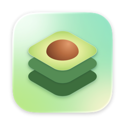
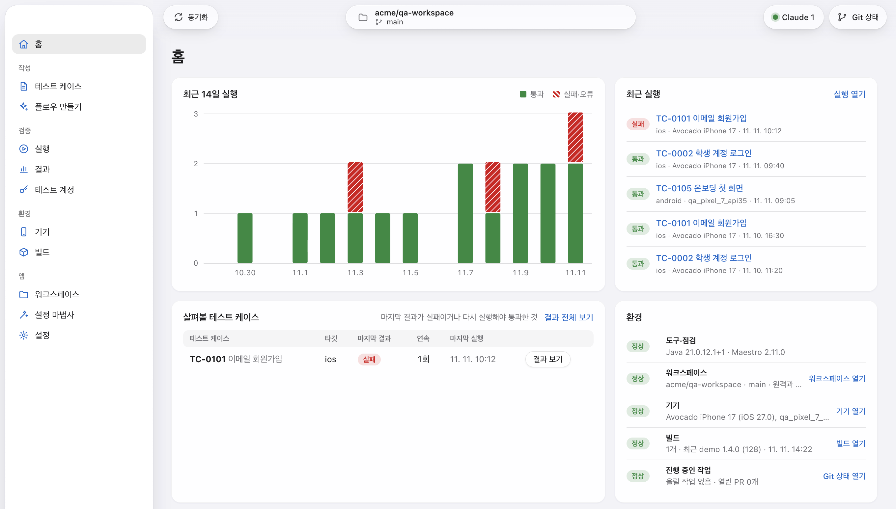
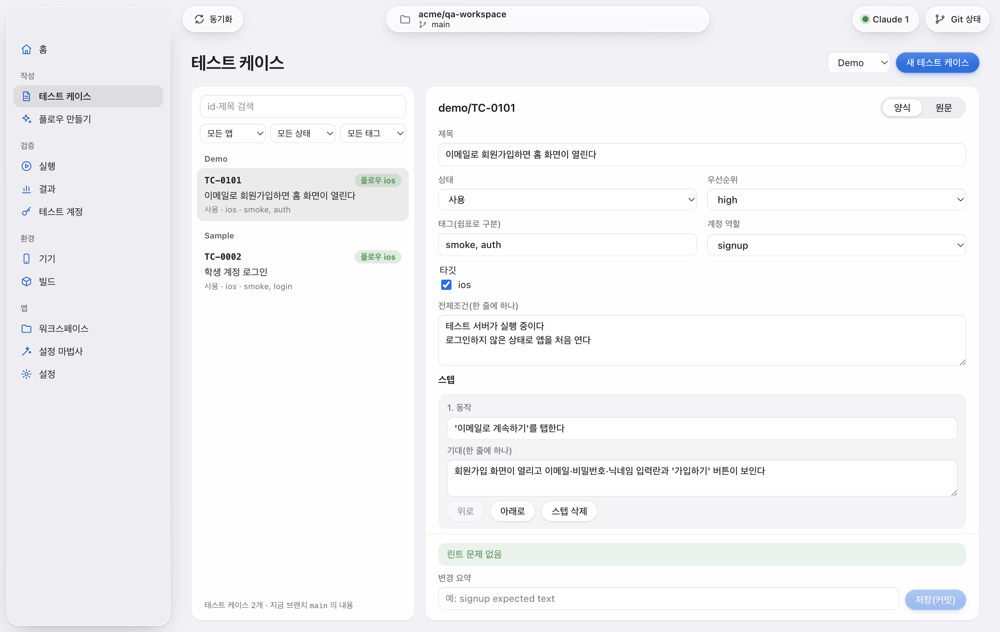
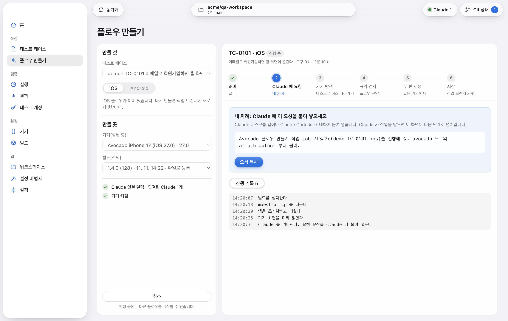
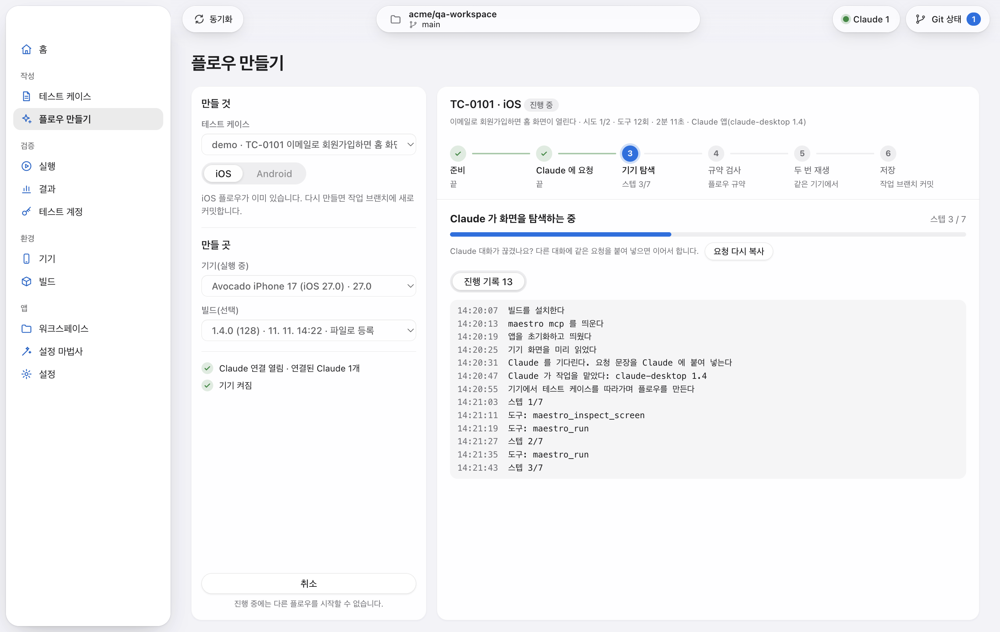
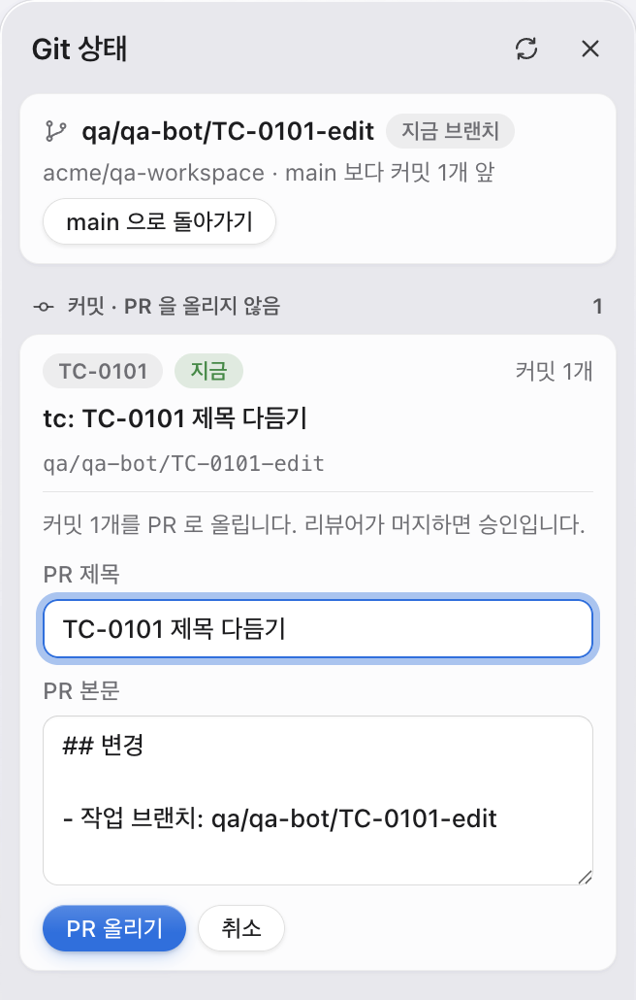
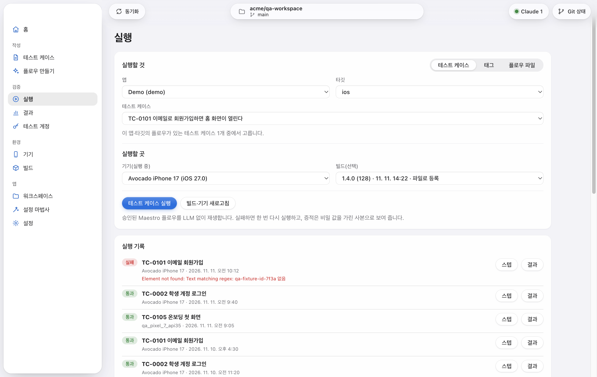
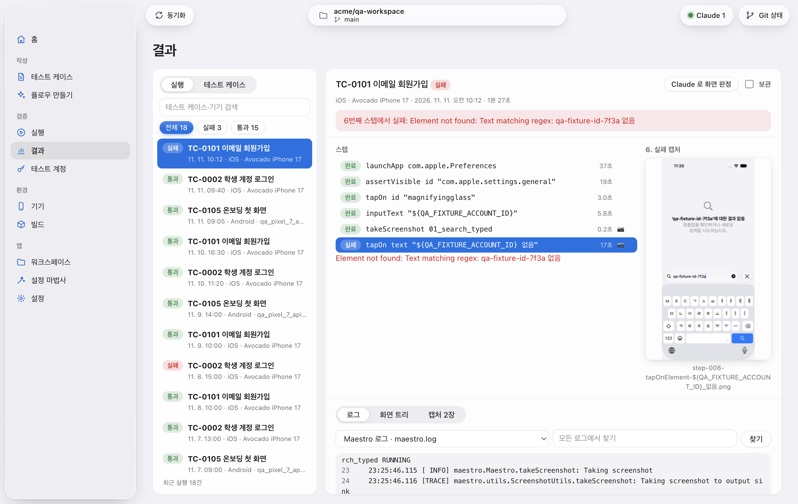

<div align="center">



# Avocado

**자연어 테스트 케이스로 모바일 앱을 검증하는 macOS 앱.**<br>
내 Claude 가 테스트 케이스를 Maestro 플로우로 만들고, 승인된 플로우는 AI 없이 재생해 스텝마다 증적을 남깁니다.

[](https://github.com/Ekko0701/Avocado/releases/latest)
[](https://github.com/Ekko0701/Avocado/releases)


[](LICENSE)

**한국어** · [English](README.en.md) · [日本語](README.ja.md)

</div>



- **테스트 케이스는 자연어로**: 기획자와 QA 가 앱의 양식에 동작과 기대 결과를 씁니다. 저장할 때 규칙 검사(린트)를 거칩니다.
- **플로우는 내 Claude 가**: Claude 데스크톱 앱이나 Claude Code 가 시뮬레이터에서 테스트 케이스를 직접 따라가며 Maestro 플로우를 만듭니다. API 키가 필요 없습니다.
- **재생에는 AI 가 없습니다**: 승인된 플로우는 Maestro 로 그대로 재생합니다. 실행할 때마다 모델을 부르지 않습니다.
- **스텝마다 증적**: 스텝 타임라인, 캡처, 화면 트리, 로그를 남깁니다. 계정 값 같은 비밀은 가린 사본으로만 보입니다.
- **서버가 없습니다**: 테스트 케이스와 플로우는 팀의 GitHub 저장소에 두고 PR 로 승인합니다. 증적 원본은 각자의 Mac 에만 있습니다.

## 설치

Avocado 는 **Apple Silicon Mac**(M1 이상)에서 동작합니다. Intel Mac 은 지원하지 않습니다.

1. [최신 릴리스](https://github.com/Ekko0701/Avocado/releases/latest)에서
   `Avocado-<버전>-arm64.dmg` 를 받습니다.
2. DMG 를 열고 **Avocado** 를 **응용 프로그램** 폴더로 끕니다.
3. 응용 프로그램 폴더에서 Avocado 를 엽니다.

릴리스는 Apple 의 서명·공증을 거쳐 보안 경고 없이 열립니다.

### 함께 필요한 것

| 항목 | 내용 |
|---|---|
| Xcode | App Store 에서 설치하고 한 번 열어 추가 구성 요소를 설치합니다. iOS 시뮬레이터 런타임도 필요합니다(Xcode → Settings → Components). |
| Claude | 플로우 만들기에 쓰는 Claude 데스크톱 앱 또는 Claude Code. 사용량은 각자의 Claude 요금제에서 나갑니다. |
| GitHub | 워크스페이스 저장소(테스트 케이스·플로우)와 그 저장소에 쓸 수 있는 토큰. 증적 요약을 올리려면 증적 저장소도 둡니다. |
| Android(선택) | Android 를 테스트할 때만 Android Studio 의 SDK 와 에뮬레이터. |

Maestro 와 Java 는 따로 설치하지 않습니다. Avocado 의 설정 마법사가 정해진 버전을 내려받아 앱 안에만 둡니다(약 360MB).

### 업데이트

새 버전이 나오면 앱에 새 버전 배너가 뜹니다. **받기**를 누르면 내려받은 파일의 SHA-256 과 서명을 확인하고, **재시작해서 업데이트**를 누르면 새 버전으로 다시 열립니다. 실행·플로우 만들기·빌드가 진행 중이면 끝난 뒤에 누릅니다.

앱이 응용 프로그램 폴더 밖에 있으면 배너의 버튼이 **설치 파일 받기**로 바뀝니다. 이때는 받은 DMG 로 다시 설치합니다.

### 삭제

1. 기기 화면에서 Avocado 가 만든 시뮬레이터(`Avocado iPhone …`)를 **삭제**합니다.
2. Avocado 를 휴지통으로 옮깁니다.
3. 저장한 것까지 지우려면 `~/Library/Application Support/Avocado` 폴더(DB, 증적, 워크스페이스, 도구, 로그)와 키체인 접근의 **Avocado Safe Storage** 항목을 지웁니다.
4. Claude 에 등록했다면 Claude 데스크톱 앱 설정 파일의 `avocado` 항목을 지우고, Claude Code 는 아래 명령을 실행합니다.

```bash
claude mcp remove avocado
```

## 사용법

### 1. 처음 설정

처음 열면 설정 마법사가 뜹니다. 여섯 단계이고, 건너뛴 단계는 나중에 왼쪽 메뉴에서 할 수 있습니다.

1. **Claude 연결**: Claude 데스크톱 앱은 **Claude 데스크톱 앱에 등록**을 누르고 Claude 를 다시 엽니다. Claude Code 는 화면의 명령을 복사해 터미널에서 한 번 실행합니다.
2. **GitHub 토큰**: Fine-grained 토큰을 넣습니다. 저장소 권한은 Contents 와 Pull requests 의 읽기·쓰기입니다.
3. **환경 점검·도구**: Xcode 와 시뮬레이터 런타임을 점검하고 Java 와 Maestro 를 설치합니다.
4. **GitHub·워크스페이스**: 저장소 목록에서 워크스페이스 저장소를 골라 연결합니다.
5. **QA 기기**: iOS 시뮬레이터를 준비합니다(1~3분).
6. **완료**

토큰과 계정 값은 macOS 키체인 키로 암호화해 이 Mac 에만 둡니다. 화면에는 저장 여부만 보입니다.

자세한 순서는 [설치와 첫 실행](docs/user-guide/install.md)에 있습니다.

### 2. 기기와 빌드 준비

- **기기**: 기기 화면에서 iOS 버전과 기종을 고르고 **iOS 시뮬레이터 준비**를 누릅니다. Avocado 전용 시뮬레이터를 만들어 언어를 맞추고 켭니다. Android 는 AVD 를 골라 **Android 에뮬레이터 준비**를 누릅니다.
- **빌드**: 빌드 화면에서 테스트할 앱을 넣습니다.
  - **프로젝트**: Xcode 프로젝트 폴더를 연결하고 스킴·구성을 골라 **빌드 시작**을 누르면 시뮬레이터용으로 빌드해 등록합니다.
  - **파일**: 직접 빌드한 시뮬레이터용 `.app` 이나 `.apk` 를 고릅니다.
  - **스크립트**: 팀의 빌드 스크립트를 실행해 등록합니다.
- **테스트 계정**: 테스트 계정 화면에서 워크스페이스가 정한 키마다 값을 넣습니다. 실행할 때만 앱이 꺼내 쓰고 증적에서는 가립니다.

### 3. 테스트 케이스 쓰기

테스트 케이스 화면에서 **새 테스트 케이스**를 누르고 양식을 채웁니다. 스텝마다 동작 하나와 기대 결과를 적습니다.



**저장(커밋)**을 누르면 린트를 통과한 내용이 그 테스트 케이스의 작업 브랜치에 커밋됩니다. main 에는 바로 올라가지 않습니다. 형식과 규칙은 [테스트 케이스 쓰기](docs/user-guide/testcase.md)에 있습니다.

### 4. Claude 로 플로우 만들기

1. Avocado 를 먼저 켜고 Claude 를 엽니다.
2. 플로우 만들기 화면에서 테스트 케이스, 타깃, 기기, 빌드를 고르고 **Claude 로 플로우 만들기**를 누릅니다.
3. "Claude 에 요청" 단계가 내 차례입니다. **요청 복사**를 눌러 Claude 대화에 붙여 넣습니다.



4. Claude 가 기기에서 테스트 케이스를 따라가며 플로우를 만듭니다. 단계 표시줄과 진행 기록으로 어디까지 왔는지 봅니다.



5. Claude 가 플로우를 내면 Avocado 가 규약을 검사하고 같은 기기에서 두 번 재생합니다. 둘 다 통과해야 작업 브랜치에 커밋됩니다.

Claude 는 계정 비밀번호 같은 값을 보지 못합니다. Avocado 가 실행할 때 넣고 결과에서 가립니다. 화면 캡처와 화면 글자는 각자의 Claude 계정으로 가므로, 민감한 화면이 있는 앱은 요금제와 "모델 개선에 참여" 설정을 먼저 확인합니다. 자세한 내용은 [내 Claude 로 플로우 만들기](docs/user-guide/claude-connect.md)에 있습니다.

### 5. PR 로 올려 승인받기



위쪽 **Git 상태**를 열면 작업 브랜치마다 커밋이 보입니다. **PR 작성**으로 제목과 본문을 쓰고 **PR 올리기**를 누릅니다. 리뷰어가 GitHub 에서 머지하면 승인입니다. Avocado 는 main 에 직접 올리지 않고 PR 을 자동으로 머지하지도 않습니다.

### 6. 실행

실행 화면에서 실행할 것과 실행할 곳을 고르고 실행 버튼을 누릅니다.

- **테스트 케이스**: 플로우가 있는 테스트 케이스 하나를 재생합니다.
- **태그**: 그 태그가 붙은 테스트 케이스를 차례로 재생합니다.
- **플로우 파일**: 워크스페이스에 없는 `.yaml` 파일을 한 번 재생합니다.



실패하면 한 번 다시 실행합니다. 다시 통과한 실행은 "불안정"으로 표시합니다.

### 7. 결과와 증적 보기

결과 화면의 왼쪽에서 실행을 고르면 오른쪽에 스텝과 실패한 스텝의 캡처가 나란히 보이고, 아래 로그 탭에는 실패한 줄이 바로 보입니다. 화면 트리와 캡처 모아 보기도 아래 탭에 있습니다.



- 왼쪽 목록은 실패·통과로 거르거나 검색합니다. **테스트 케이스** 탭은 테스트 케이스 × 타깃 표로 마지막 결과를 보여 줍니다.
- **Claude 로 화면 판정**은 캡처가 정상 화면인지 Claude 에게 묻습니다. 판정은 배지로만 보이고 실행 결과를 바꾸지 않습니다.
- 화면에 보이는 증적은 비밀 값을 가린 사본입니다. 원본은 이 Mac 에만 있습니다.

### 지원 범위

| 대상 | 지원 | 비고 |
|---|---|---|
| iOS 시뮬레이터 | ✅ | Xcode 프로젝트 폴더 또는 시뮬레이터용 `.app` |
| Android 에뮬레이터 | ✅ | `.apk` |
| Android 폰 | ⚠️ | USB 디버깅으로 연결합니다. 구현돼 있지만 실제 폰에서 충분히 확인하지 못했습니다. |
| iPhone 실기기 | ❌ | 아직 지원하지 않습니다. TestFlight 빌드도 실기기용이라 쓸 수 없습니다. |
| Android `.aab`, Gradle 프로젝트 빌드 | ❌ | `.apk` 로 만들어 등록합니다. |

## 문서

- [설치와 첫 실행](docs/user-guide/install.md)
- [내 Claude 로 플로우 만들기](docs/user-guide/claude-connect.md)
- [테스트 케이스 쓰기](docs/user-guide/testcase.md)
- [예시 워크스페이스](examples/qa-workspace): 가상 앱으로 만든 테스트 케이스·플로우 예

## 개발

소스에서 빌드하는 방법과 저장소 구조는 [docs/development.md](docs/development.md)에 있습니다.

## 라이선스

[MIT](LICENSE) © 2026 Ekko0701
